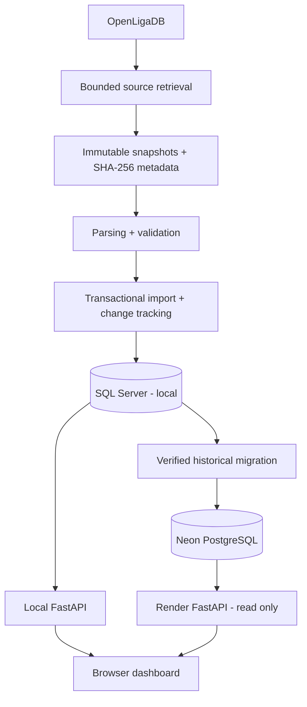

# Sports Fixtures & Change Tracker

**An auditable football fixture tracker with historical change detection, match analytics, and a public web dashboard.**

[](https://www.python.org/)
[](https://fastapi.tiangolo.com/)
[](https://www.postgresql.org/)
[](https://render.com/)
[](https://www.openligadb.de/)

### [**Open the live dashboard**](https://sports-fixtures-change-tracker.onrender.com/) 

> **Coverage:** UEFA Champions League **2026/2027 league phase** (matchdays 1–8). This project tracks stored source observations and changes; it is **not** an official UEFA service or a guaranteed real-time score feed.

## Overview

Sports Fixtures & Change Tracker collects football fixture data from OpenLigaDB, validates it before import, and preserves what changed between observations. It is built around a simple question: **not just what does a fixture say now, but what did the source report previously, and how did it change?**

The project has two connected deployment paths:

- **Local data pipeline:** immutable OpenLigaDB response snapshots, validation, transactional import, and historical change tracking in Microsoft SQL Server.
- **Public, read-only dashboard:** FastAPI and a lightweight HTML/CSS/JavaScript frontend hosted on Render, reading from a migrated Neon PostgreSQL database.

The cloud database contains a verified historical copy of the local data. **The deployed site does not run unattended OpenLigaDB synchronization.**

## Explore the dashboard

| Section | What you can explore |
| --- | --- |
| **Overview** | Competition context, fixture totals, completed and upcoming matches, stored goal-event counts, recorded changes, and upcoming fixtures. |
| **Match Explorer** | Search and filter fixtures by team, matchday, or status, with server-side pagination and predictable chronological ordering. |
| **Insights** | Read-only team, matchday, score, result, and goal-event summaries derived from stored records. |
| **Change Intelligence** | Fixture and result history, field-level before/after values, and source provenance where available. |

**[Launch the dashboard →](https://sports-fixtures-change-tracker.onrender.com/)**

A *Last updated* timestamp represents the latest successful recorded synchronization, **not** a promise that the source was checked at that moment. An unfinished match is not automatically considered live, and missing scores are not displayed as `0–0`.

## Data coverage and verification

The implemented competition is **Champions League 2026/2027**. The internal source season key is `2026` (`ucl`, OpenLigaDB league ID `4946`); the user-facing competition name does not append the key again.

The following is an **owner-verified historical database snapshot**, not a continuously refreshed count or a live match result:

| Measure | Recorded value |
| --- | ---: |
| League-phase fixtures | **144** |
| Finished / unfinished fixtures | **72 / 72** |
| Stored result rows | **143** |
| Stored goal-event rows | **291** |
| Historical field-level changes | **936** |
| Teams represented | **36** |
| League-phase matchdays | **8** |

Result rows and goal-event rows are database records, not necessarily the number of finished matches or goals scored. In the cloud migration verification, **all 12 checked domain tables matched** between SQL Server and Neon PostgreSQL. The live `/api/competitions` endpoint was also observed responding with HTTP 200 after deployment configuration was corrected (November 13, 2026).

## Engineering highlights

- **Immutable evidence:** each captured response is stored with request metadata, retrieval time, byte count, and SHA-256 hash; existing captures are never overwritten.
- **Validation before import:** checks cover provider identity, match IDs, timestamps, teams, result types, and score relationships.
- **Transactional database writes:** fixtures, scores, events, change history, checkpoints, and import-run evidence are handled together.
- **Idempotent replay:** an unchanged source snapshot can be reprocessed without fabricating new changes.
- **Field-level change tracking:** historical observations are distinguishable from the current fixture state.
- **Read-only public access:** the Render deployment is designed for public browsing, not public database writes; data modifications and synchronization are separate gated workflows.
- **Inspectable frontend:** no frontend framework is required—just HTML, CSS, and JavaScript served by FastAPI.

### Architecture



**Important:** the migration arrow represents a verified transfer, **not** continuous replication. Original raw snapshot files currently remain outside the public Render service.

### Example: conflicting source results

One Matchday 2 snapshot included conflicting halftime results for provider match `87412` (Viking vs FC Bayern München): `2–0` and `0–0`, while the separately validated final result was `3–3`. The pipeline rejects ambiguous data by default. Its explicit recovery path can quarantine the conflicting non-final variants, retain the original evidence, and preserve independently validated final-score data without arbitrarily selecting a halftime score.

See [source notes](docs/SOURCE_NOTES.md), [architecture](docs/ARCHITECTURE.md), and the [manual runbook](docs/MANUAL_RUNBOOK.md) for the audit and recovery boundaries.

## Technology stack

| Area | Technologies |
| --- | --- |
| Data collection and validation | Python, `httpx`, Pydantic |
| Local persistence | Microsoft SQL Server, `pyodbc`, ODBC Driver 18 |
| Cloud persistence | PostgreSQL on Neon, `psycopg` 3 |
| Backend | FastAPI, Uvicorn |
| Frontend | HTML, CSS, vanilla JavaScript |
| Hosting | Render web service |
| Quality checks | pytest, Ruff, SQL parity and snapshot checks |
| Football data provider | OpenLigaDB |

## Run locally

This section covers the **local SQL Server workflow**; it assumes SQL Server, the required ODBC driver, and database configuration are available.

```bash
git clone https://github.com/emam26/sports-fixtures-change-tracker.git
cd sports-fixtures-change-tracker

python3 -m venv .venv
source .venv/bin/activate
python -m pip install --editable '.[dev,sqlserver]'
cp .env.example .env
```

Configure `.env` with your **own local** settings. Never commit `.env`, database URLs, passwords, snapshots, or logs.

Once the database is configured, run the local dashboard:

```bash
python scripts/run_api.py --host 127.0.0.1 --port 8000
```

Open **http://127.0.0.1:8000/**.

For existing snapshots, the project provides offline evaluation, dry-run import, and replay commands:

```bash
python scripts/evaluate_snapshot.py "<SNAPSHOT_DIRECTORY>"
python scripts/import_snapshot.py --snapshot "<SNAPSHOT_DIRECTORY>" --dry-run
```

Read [the manual runbook](docs/MANUAL_RUNBOOK.md) before running a real import or synchronization; those operations can write to the database and request fresh provider data.

### Validation

```bash
ruff check .
ruff format --check .
python -m pytest -q -m "not sqlserver and not neon"
```

The latest owner-reported local verification included **209 passing tests, 2 deselected**, and a Starlette deprecation warning. This is historical verification, not an automatically updating CI badge or a claim that tests were rerun for this README edit.

## Repository map

| Path | Purpose |
| --- | --- |
| [`src/sports_tracker/`](src/sports_tracker/) | Source client, snapshot management, validation, import, persistence, API, analytics, and synchronization |
| [`src/sports_tracker/web/`](src/sports_tracker/web/) | Browser interface and assets |
| [`scripts/`](scripts/) | Manual capture, migration, parity, import, replay, diagnostics, and API entry points |
| [`sql/`](sql/) | SQL Server schema and recovery scripts |
| [`tests/`](tests/) | Automated checks and opt-in integration tests |
| [`docs/`](docs/) | System design, deployment, operations, evidence, and testing documentation |
| `data/raw/` | Local immutable source snapshots (ignored by Git) |

### Documentation

| Guide | Start here for… |
| --- | --- |
| [Architecture](docs/ARCHITECTURE.md) | Components, data boundaries, and persistence design |
| [API](docs/API.md) | Dashboard and service endpoint contracts |
| [Project state](docs/PROJECT_STATE.md) | Current milestones, decisions, and outstanding tasks |
| [Build plan](docs/BUILD_PLAN.md) | Implementation phases and evidence ledger |
| [Manual runbook](docs/MANUAL_RUNBOOK.md) | Safe operation, troubleshooting, imports, and recovery |
| [Testing](docs/TESTING.md) | Unit, integration, and verification strategy |
| [Deployment feasibility](docs/POSTGRES_DEPLOYMENT_FEASIBILITY.md) | PostgreSQL/Neon migration design and constraints |
| [Source notes](docs/SOURCE_NOTES.md) | OpenLigaDB observations and provider caveats |

## Deployment status and limitations

| Component | Status |
| --- | --- |
| Local SQL Server data pipeline | Implemented and owner-verified |
| Historical SQL Server → Neon migration | Verified (12/12 checked tables matched) |
| Render-hosted public dashboard | **Deployed**; database API connectivity verified |
| Public API write access | Disabled by deployment design |
| Automatic cloud source synchronization | **Not enabled** |
| Durable cloud storage for raw source snapshots | **Not yet configured** |
| Knockout-stage tracking and other competitions | Outside verified current scope |

Additional boundaries: OpenLigaDB is a community-maintained source; data may be incomplete or delayed. The dashboard does not claim official UEFA standings, xG, possession, guaranteed live scores, or uninterrupted availability. Render's free service may have cold-start delays after inactivity.

---

**[Visit the live dashboard](https://sports-fixtures-change-tracker.onrender.com/)** · **[Browse the code](https://github.com/emam26/sports-fixtures-change-tracker)**
