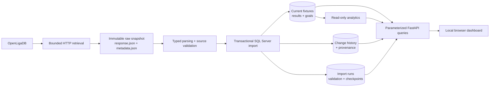

# Sports Fixtures & Change Tracker


A local-first football data pipeline that preserves OpenLigaDB observations, validates
and imports them transactionally into Microsoft SQL Server, records field-level
changes, and presents the resulting fixture history through a small FastAPI service
and a framework-free browser dashboard.

The project is deliberately designed as an auditable data-engineering system rather
than a live-score scraper. Raw source bytes, provenance, validation outcomes, current
records, and observed changes remain distinguishable throughout the pipeline.

## What is currently tracked

The implemented competition scope is the UEFA Champions League 2026/27 league phase:

| Setting | Value |
| --- | --- |
| Provider | OpenLigaDB |
| Shortcut | `ucl` |
| Season | `2026` |
| Expected league ID | `4946` |
| League-phase matchdays | 1–8 |
| Expected league-phase fixtures | 144 |

Provider and competition settings remain configurable for future source reviews, but
this README makes no claim that another competition is implemented. Knockout-stage
groups are a later scope expansion and require explicit source-shape review.

## Verified evidence snapshot

The latest owner-supplied verification reports the following state in the dedicated
local SQL Server database:

| Observation | Reported value | Interpretation |
| --- | ---: | --- |
| Unique league-phase fixtures | 144 | Fixture rows for the configured Matchdays 1–8 |
| Finished fixtures | 72 | Fixtures with a validated final result |
| Unfinished fixtures | 72 | Fixtures without a reported final result |
| Stored result records | 143 | Result rows, not a count of matches or scores |
| Stored goal-event records | 291 | Goal-event rows, not a claim of 291 goals scored |
| Historical field-level changes | 936 | Persisted transitions in `match_changes` |
| Teams exposed by the API | 36 | Returned by the verified local API observation |
| Matchdays exposed by the API | 8 | Returned by the verified local API observation |

The same owner-supplied verification reports successful local SQL Server connectivity,
successful dashboard API reads for summary, teams, and matchdays, and Match Explorer
sorting checked against stored fixtures. These are evidence from the project owner,
not results executed during this handoff. Older source notes may still describe the
earlier Matchday 3/4 capture milestone; the table above records the newer reported
database state without rewriting historical provenance.

An earlier automated verification supplied by the owner reported 129 tests passing,
one SQL Server integration test deselected, Ruff lint passing, and Ruff formatting
passing. Later implementation and dashboard edits remain **NOT RUN in this handoff**.

## Dashboard

The public local dashboard is intentionally focused on football information rather
than operational internals. Its navigation is:

1. **Overview** — competition context, fixture totals, finished/upcoming counts,
   recorded goal-event totals, detected changes, upcoming fixtures, and a human-readable
   **Last updated** value derived from the latest successful backend evidence.
2. **Match Explorer** — server-side filtering and pagination by team, matchday, and
   status. Completed fixtures default to newest known kickoff first; Upcoming uses the
   nearest known kickoff first; All shows completed fixtures newest-first followed by
   upcoming fixtures nearest-first. Missing kickoffs follow known kickoffs, and provider
   match IDs provide deterministic tie-breaking.
3. **Insights** — read-only summary, team, matchday, result, and goal-event analytics
   calculated from valid stored data. These are analytical summaries, not official UEFA
   standings or tiebreakers.
4. **Change Intelligence** — understandable fixture, result, and goal-event history
   grouped from the underlying field-level records, with before/after values and source
   provenance where available.

The interface uses browser-local rendering for reliable timezone-aware kickoff values,
keeps future scores absent/`NULL`, and does not treat an unfinished fixture as live.
Source text is rendered safely in the browser. The application remains local-only and
binds to loopback by default.

## Engineering achievements

- **Immutable source capture:** original response bytes are saved as `response.json`
  beside metadata containing the request identity, retrieval time, byte count, and
  SHA-256 hash. Existing snapshots are never overwritten.
- **Explicit source contracts:** the importer checks the top-level JSON shape, provider
  competition identity, match IDs, timestamps, team identity, result categories, and
  score relationships before changing current data.
- **Honest future state:** a match with no reported result keeps its score absent or
  `NULL`; the importer never converts missing data into a fabricated 0–0.
- **Transactional persistence:** fixture, result, goal, provenance, change-history,
  validation, run-status, and checkpoint writes are coordinated through SQL Server
  transaction boundaries. Failed imports retain useful failure provenance without
  presenting partial current data as successful.
- **Replay safety:** provider IDs and database uniqueness constraints make replaying an
  unchanged snapshot idempotent. Unchanged replays do not create false business
  changes.
- **Conflict recovery:** the Matchday 2 conflict for provider match `87412` is handled
  with strict validation by default. The explicitly enabled recovery path quarantines
  conflicting non-final variants, preserves the raw snapshot, records the conflicting
  result IDs and values, and retains only independently valid final-score data. It does
  not choose an arbitrary halftime score.
- **Safe application boundary:** FastAPI exposes parameterized, read-oriented queries;
  note writes are separately gated; credentials and complete connection strings are
  not returned by status endpoints or written to logs.
- **Small, inspectable frontend:** the dashboard uses plain HTML, CSS, and JavaScript
  so the rendering and security boundary remain easy to audit.

## Architecture



The same snapshot can be evaluated or replayed offline without another provider
request. The synchronizer is a bounded one-shot operation that can select due
matchday work and discover configured provider groups; it is not an infinite FastAPI
loop or a claim of unattended production operation.

## Data quality case study: conflicting Matchday 2 results

OpenLigaDB supplied two conflicting `HalfTime` rows for match `87412` (Viking vs FC
Bayern München): result `129519` reported 2–0 and result `129520` reported 0–0. The
`After90Minutes` row `129521` reported 3–3.

The safe policy is:

- strict conflict rejection is the default;
- recovery must be explicitly enabled and is limited to conflicting non-final result
  categories;
- both conflicting variants remain represented in validation/quarantine provenance;
- the raw snapshot is immutable;
- the final result is retained only after independent identity and score validation;
- no halftime value is selected arbitrarily.

The owner-reported recovery outcome is that the Matchday 2 import completed with the
unambiguous 3–3 final result, while the stored result total reconciled to 143 and the
936 historical changes were preserved. This outcome was not re-executed during this
README-only handoff.

## Reproducible local workflow

The commands below are for manual execution by the project owner. They are included
for reproducibility and were **not run while preparing this README**.

### Set up WSL

```bash
cd /mnt/f/sports-fixtures-change-tracker
python3 -m venv .venv
source .venv/bin/activate
python -m pip install --editable '.[dev]'
cp .env.example .env
```

Keep real local settings only in `.env`. Never commit or paste that file, a password,
or a complete connection string. The Windows host IP visible from WSL can change after
a WSL or network restart, so reconfirm it before database operations.

### Offline validation first

These steps do not require a new OpenLigaDB request. Replace the placeholder with an
existing immutable snapshot directory.

```bash
cd /mnt/f/sports-fixtures-change-tracker
source .venv/bin/activate
ruff check .
ruff format --check .
python -m pytest -q -m "not sqlserver"
python scripts/evaluate_snapshot.py "<SNAPSHOT_DIRECTORY>"
python scripts/import_snapshot.py --snapshot "<SNAPSHOT_DIRECTORY>" --dry-run
python scripts/report_season_coverage.py
```

The expected dry-run shape is a parsed match count and validation summary without SQL
writes. A coverage report must distinguish an unavailable provider matchday from an
import failure; it must not manufacture missing fixtures.

### SQL Server and API verification

Run the SQL Server integration test only when the dedicated local database and `.env`
are ready:

```bash
python -m pytest tests/test_sqlserver_integration.py -m sqlserver -q
```

After database verification, start the local API on loopback:

```bash
python scripts/run_api.py --host 127.0.0.1 --port 8000
```

Open <http://127.0.0.1:8000/> and check the four sections, fixture filters, completed
and upcoming ordering, missing-score rendering, Insights responses, Change Intelligence,
and the Last updated value. A browser check is separate evidence from a passing unit
test.

### Source capture, discovery, and replay

Inspect the provider’s available groups before a one-time backfill:

```bash
python scripts/discover_openligadb_season.py
```

Capture only groups reported by that read-only discovery review. Validate every
immutable snapshot and import it separately:

```bash
python scripts/evaluate_snapshot.py "<SNAPSHOT_DIRECTORY>"
python scripts/import_snapshot.py --snapshot "<SNAPSHOT_DIRECTORY>" --dry-run
python scripts/import_snapshot.py --snapshot "<SNAPSHOT_DIRECTORY>"
```

For future bounded synchronization, the documented one-shot entry point is:

```bash
python scripts/sync_openligadb.py --discover
```

The last command makes real source requests and SQL writes. OpenLigaDB documents a
60-requests-per-minute limit; aggressive polling is prohibited. No cloud deployment,
Windows Task Scheduler configuration, or unattended production run is claimed here.

## Technology stack

- Python 3.11+; the owner’s reported environment used Python 3.14
- `httpx` for bounded, testable HTTP retrieval
- `pyodbc` 5.3.0 and Microsoft SQL Server 2025 with ODBC Driver 18
- `python-dotenv` for local configuration
- FastAPI, Pydantic, and Uvicorn
- pytest and Ruff
- Plain HTML, CSS, and JavaScript

## Repository guide

| Path | Purpose |
| --- | --- |
| [`src/sports_tracker/`](src/sports_tracker/) | Configuration, source client, snapshots, ingestion, synchronization, API, and analytics |
| [`src/sports_tracker/web/`](src/sports_tracker/web/) | Dashboard HTML, JavaScript, and CSS |
| [`scripts/`](scripts/) | Manual capture, evaluation, import, discovery, synchronization, reporting, and API entry points |
| [`sql/`](sql/) | SQL Server schema and manual recovery scripts |
| [`tests/`](tests/) | Offline unit/API tests and opt-in SQL Server integration tests |
| [`docs/ARCHITECTURE.md`](docs/ARCHITECTURE.md) | Design boundaries and data mappings |
| [`docs/API.md`](docs/API.md) | API contracts and endpoint behavior |
| [`docs/BUILD_PLAN.md`](docs/BUILD_PLAN.md) | Staged implementation status and evidence log |
| [`docs/DEPLOYMENT_LOCAL.md`](docs/DEPLOYMENT_LOCAL.md) | Local scheduling and deployment notes |
| [`docs/EVALUATION.md`](docs/EVALUATION.md) | Evaluation plan and operational metrics |
| [`docs/MANUAL_RUNBOOK.md`](docs/MANUAL_RUNBOOK.md) | Manual setup, verification, recovery, and operation |
| [`docs/SOURCE_NOTES.md`](docs/SOURCE_NOTES.md) | Provider observations and source caveats |
| [`docs/TESTING.md`](docs/TESTING.md) | Test strategy and verification boundaries |
| [`data/raw/`](data/raw/) | Local immutable snapshots; ignored by Git |

## Known limitations and evidence boundaries

- OpenLigaDB is a community source, not an official UEFA data feed. Provider
  availability, labels, timestamps, and result completeness must be checked per
  snapshot.
- The 144/72/72/143/291/936 values above are an owner-reported verification snapshot,
  not a live query performed for this README. They describe stored rows and change
  records, not guaranteed real-time football state.
- The current working tree includes later dashboard and synchronization changes whose
  lint, test, SQL, API, source, and browser checks remain NOT RUN in this handoff.
- A scheduler-ready bounded command exists, but automatic import, end-to-end freshness
  movement, unattended recovery, public hosting, and cloud deployment are not
  established evidence.
- The dashboard does not provide guaranteed live scores, possession, xG, an official
  UEFA table, or a public multi-user authorization system.
- Missing kickoff metadata and ambiguous source timezone metadata are retained as
  uncertainty; the application does not invent chronology.
- Raw snapshots, `.env`, database backups, logs, and local virtual environments must
  remain local and ignored. No password or secret belongs in this repository.

For the full operational caveats and the evidence ledger, start with
[`docs/MANUAL_RUNBOOK.md`](docs/MANUAL_RUNBOOK.md) and
[`docs/BUILD_PLAN.md`](docs/BUILD_PLAN.md).
